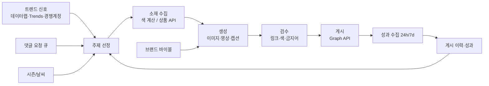

# 레퍼런스 분석과 콘텐츠 정보 수집 설계

작성일: 2026-10-20

## 1. 레퍼런스 분석

### A. Art Craft Blend (@artcraftblend)

- 규모: 팔로워 약 400만, 게시물 1,159개 (2026-10-20 기준 공개 메타데이터)
- 포맷: 아크릴 물감 두세 가지를 팔레트에서 섞어 새 색을 만드는 짧은 릴스. "무슨 색이 나올까(guess the color)" 구조에 ASMR 느낌의 소리와 색 변화가 전부이고, 말은 거의 없다.
- 왜 먹히나
  - 언어가 필요 없어 전 세계 노출이 가능하다.
  - "무슨 색이 나올까"라는 궁금증 때문에 끝까지 보고, 짧아서 반복 재생이 잘 된다.
  - 포맷이 고정되어 있어 매일 찍어내기 쉽다. 바뀌는 건 색 조합뿐이다.
- 수익화: 자체 사이트(artcraftblend.com)에서 색 혼합 가이드 eBook "The Art of Blending"을 $7.99에 판매. 같은 영상을 스냅챗 등 다른 플랫폼에도 올린다. 팔로워 규모에 비해 수익 구조는 단순하다.
- AI 운영 관점
  - 매일 필요한 정보가 "오늘의 색 조합" 하나라서 정보 수집 부담이 가장 작다.
  - 대신 승부는 영상 품질이다. 실제 물감의 점성, 소리, 섞이는 물리감이 핵심인데 AI 영상이 어색하면 바로 티가 난다.
  - 결과 색이 틀리면(파랑+노랑=보라 같은) 댓글에서 지적당한다. 결과 색은 생성 모델에 맡기지 말고 계산해서 지정해야 한다.

### B. 실루 | 하체비만 체형보완 (@silou_official_)

- 규모: 팔로워 약 2.1만, 게시물 20개. 게시물 수 대비 성장이 매우 빠르다.
- 분석한 릴스: "꾸안꾸 느낌 좋은 컬러조합 추천" (2026-08-27), 좋아요 2,651 / 댓글 376
- 포맷: 흰 스튜디오 배경, 남녀 모델 전신 코디, 큰 자막 훅. 캡션은 "댓글 남기면 코디정보 링크모음 DM 드릴게요".
- 왜 먹히나
  - 타깃이 좁고 고민이 분명하다(하체비만 체형 보완). 저장과 공유가 잘 나오는 주제다.
  - 댓글→DM 자동응답 구조가 댓글 수를 끌어올리고, 댓글이 많으니 알고리즘이 더 노출한다. 좋아요 대비 댓글 비율(약 14%)이 비정상적으로 높은 이유가 이것이다.
  - DM으로 보내는 링크가 제휴 링크(쿠팡 파트너스, 쇼핑몰 큐레이터 프로그램 등)일 가능성이 높다. 팔로워가 적어도 바로 돈이 된다.
- AI 운영 관점
  - 매일 실제 상품 정보(상품명, 가격, 링크, 이미지, 재고)가 필요해서 정보 수집 부담이 가장 크다.
  - 이미지 속 옷과 링크 속 상품이 다르면 신뢰가 무너진다. 따라서 "상품을 먼저 고르고, 그 상품을 입힌 이미지를 만드는" 순서가 필수다(가상 착용, virtual try-on).
  - 모델이 AI인지는 썸네일만으로 확정할 수 없다. 다만 동일 인물, 동일 배경을 매일 유지하는 이 포맷은 AI 캐릭터로 재현하기 좋은 구조다.

### 두 컨셉 비교

| 항목 | A. 물감 블렌딩 | B. 체형 보완 코디 |
|---|---|---|
| 매일 필요한 정보 | 색 조합 1개 | 실제 상품 3~5개 + 트렌드 |
| 정보 수집 난이도 | 낮음 | 높음 |
| 생성 난이도 | 높음 (물리감 있는 영상) | 중간 (인물 일관성 + 가상 착용) |
| 시장 | 글로벌 | 국내 |
| 수익화 속도 | 느림 (규모가 커져야 함) | 빠름 (제휴 링크) |
| 실패 지점 | AI 영상 티, 틀린 결과 색 | 링크-이미지 불일치, 품절 링크 |

## 2. 정보 수집 설계

AI가 매일 글을 만들려면 정보가 여섯 종류 필요하다. 두 컨셉 모두 같은 틀을 쓰고, 컨셉에 따라 2번(소재)만 달라진다.

| # | 정보 | 역할 | 갱신 주기 |
|---|---|---|---|
| 1 | 브랜드 바이블 | 페르소나, 말투, 포맷 템플릿, 금지 사항 | 사람이 작성, 가끔 수정 |
| 2 | 소재 데이터 | 오늘 다룰 실제 내용 (색 조합 / 상품) | 매일 |
| 3 | 트렌드 신호 | 무엇을 다룰지 고르는 기준 | 매일~매주 |
| 4 | 시즌/캘린더 | 날씨, 계절, 기념일, 세일 기간 | 매일 |
| 5 | 내 성과 데이터 | 어떤 글이 잘 됐는지 피드백 | 게시 후 24h, 7일 |
| 6 | 댓글/DM | 팔로워 요청, 질문, 반응 | 실시간~매일 |
| 7 | 게시 이력 DB | 중복 방지, 시리즈 관리 | 게시할 때마다 |

### 2-1. 브랜드 바이블 (사람이 1회 작성)

AI가 매일 흔들리지 않게 하는 고정 정보다. 파일 하나(예: brand.yaml)로 관리한다.

- 계정 정체성: 누구를 위한 계정인지, 한 줄 소개
- 캐릭터 설정(B): 얼굴 레퍼런스 이미지, 체형, 헤어, 표정 범위
- 포맷 템플릿: 훅 문구 패턴, 자막 위치/폰트/색, 영상 길이, 캡션 구조, 해시태그 세트
- 금지 사항: 특정 브랜드, 과장 표현, 체형 비하 표현 등

### 2-2. 소재 데이터

**A. 물감 블렌딩**

- 색 조합 후보: 직접 만든 색 목록(이름 + HEX) + Pantone 올해의 색, 트렌드 컬러 발표, 시즌 팔레트
- 결과 색 계산: 실제 물감처럼 섞이는 감산 혼합 모델(예: Mixbox 라이브러리, Kubelka-Munk 방식)로 결과 HEX를 먼저 계산하고, 영상 생성 프롬프트에 그 색을 지정한다.
- 색 이름: 결과 색에 붙일 이름(예: "Dark Gold")은 AI가 짓되 색 이름 DB로 근거를 둔다.
- 팔로워 요청: "X랑 Y 섞어주세요" 댓글이 가장 좋은 소재다. 댓글에서 색 이름을 추출해 큐에 넣는다.

**B. 체형 보완 코디**

- 상품 정보: 제휴 프로그램 API를 우선 쓴다.
  - 쿠팡 파트너스 API: 상품 검색, 가격, 이미지, 제휴 딥링크 생성
  - 네이버 쇼핑 검색 API: 상품 검색과 가격 비교
  - 패션 플랫폼 큐레이터/제휴 프로그램(무신사, 29CM, 에이블리 등): 조건과 API 제공 여부를 개별 확인해야 한다.
- 스크래핑은 최후 수단이다. 랭킹 페이지 크롤링은 약관 위반 소지가 있고 구조가 바뀌면 파이프라인이 멈춘다.
- 스타일링 규칙: "하체비만 보완" 원칙(하이웨이스트, 와이드 핏, 상체 포인트 등)을 규칙 문서로 만들어 AI가 상품 조합을 고를 때 기준으로 쓴다.
- 링크 검증: 게시 직전에 링크가 살아 있는지, 품절인지, 가격이 바뀌었는지 다시 확인한다.

### 2-3. 트렌드 신호

- 네이버 데이터랩 API(검색어 트렌드, 쇼핑인사이트): 국내 패션 카테고리/키워드 클릭 추이. B의 핵심 소스.
- Google Trends: 글로벌 키워드 흐름. A에 유용.
- Instagram 해시태그 검색 API: 특정 해시태그의 인기 게시물 조회 (7일간 고유 해시태그 30개 제한).
- Instagram Business Discovery API: 경쟁 계정(비즈니스/크리에이터 계정)의 공개 게시물과 좋아요/댓글 수 조회. 레퍼런스 계정 모니터링을 크롤링 없이 할 수 있다.
- Pinterest Trends: 시즌 컬러, 코디 키워드.

### 2-4. 시즌/캘린더

- 기상청 단기예보 API 또는 OpenWeather: 기온에 맞는 옷차림(B), 계절감 있는 색(A)
- 공휴일/기념일, 쇼핑 이벤트(블랙프라이데이, 시즌 오프 세일) 캘린더: 직접 만든 표로 관리

### 2-5. 내 성과 데이터 (가장 중요한 피드백)

- Instagram Graph API 인사이트: 도달, 조회, 저장, 공유, 댓글, 팔로우 유입, 릴스 시청 지속
- 게시 후 24시간, 7일 두 번 수집해 이력 DB에 붙인다.
- 이 데이터로 "어떤 훅/색/상품군이 잘 되는가"를 주간 단위로 요약해 다음 주 주제 선정에 반영한다.
- B는 제휴 클릭/전환 리포트도 함께 수집한다(쿠팡 파트너스 리포트 등).

### 2-6. 댓글/DM

- Instagram Graph API로 댓글 수집, Messenger/Instagram 메시징 API로 DM 처리
- 댓글 키워드 → DM 자동 발송은 B의 핵심 구조. 직접 구현하거나 ManyChat 같은 공식 파트너 도구를 쓴다.
- 댓글에서 요청(색 조합, 체형 고민, 상황별 코디)을 뽑아 소재 큐에 넣는다.

### 2-7. 게시 이력 DB

- 게시물마다 저장: 날짜, 주제, 사용한 색/상품 ID, 훅 문구, 해시태그, 생성 프롬프트, 성과 지표
- 용도: 같은 조합/상품 반복 방지, 시리즈 연재, 성과 분석의 기준

## 3. 하루 흐름

1. 전날 밤: 트렌드, 날씨, 댓글 요청, 지난 성과를 모아 다음 날 주제 후보 3개 생성
2. 주제 1개 선택 (초기에는 사람이 고르고, 패턴이 잡히면 AI에 맡김)
3. 소재 수집: A는 결과 색 계산, B는 상품 검색과 제휴 링크 생성
4. 생성: 이미지/영상, 자막, 캡션, 해시태그
5. 자동 검수: 링크 유효성, 결과 색 일치, 금지 표현, 중복 여부
6. 게시: Instagram Content Publishing API로 정해진 시간에 업로드
7. 성과 수집 후 이력 DB 갱신

## 4. 미리 알아둘 제약

- API 게시를 하려면 비즈니스 또는 크리에이터 계정이 필요하다.
- API로 릴스를 올리면 인스타그램 앱 내 음원 라이브러리를 붙일 수 없다. 소리는 영상 파일에 직접 넣어야 한다. A는 물감 소리 자체가 콘텐츠라 문제가 작고, B는 저작권 문제 없는 음원을 따로 준비해야 한다.
- 사실적인 AI 생성 인물/영상은 Meta의 AI 라벨 정책 대상이다. 게시할 때 AI 정보 표시를 켜는 것을 기본값으로 둔다.
- 제휴 링크 게시물은 광고 표기(예: "쿠팡 파트너스 활동의 일환으로 수수료를 받을 수 있음")가 필요하다. 캡션 템플릿과 DM 문구에 고정해 둔다.

## 5. 다음에 정할 것

- 컨셉 A, B 중 무엇으로 시작할지 (또는 둘 다 시험 운영)
- 수익화 우선순위: 빠른 제휴 수익 vs 글로벌 규모
- 사람 검수를 어디까지 남길지 (초기 2~4주는 게시 전 승인 권장)
- 생성 도구 선정: 이미지/영상 모델, 인물 일관성 방법, 가상 착용 도구

